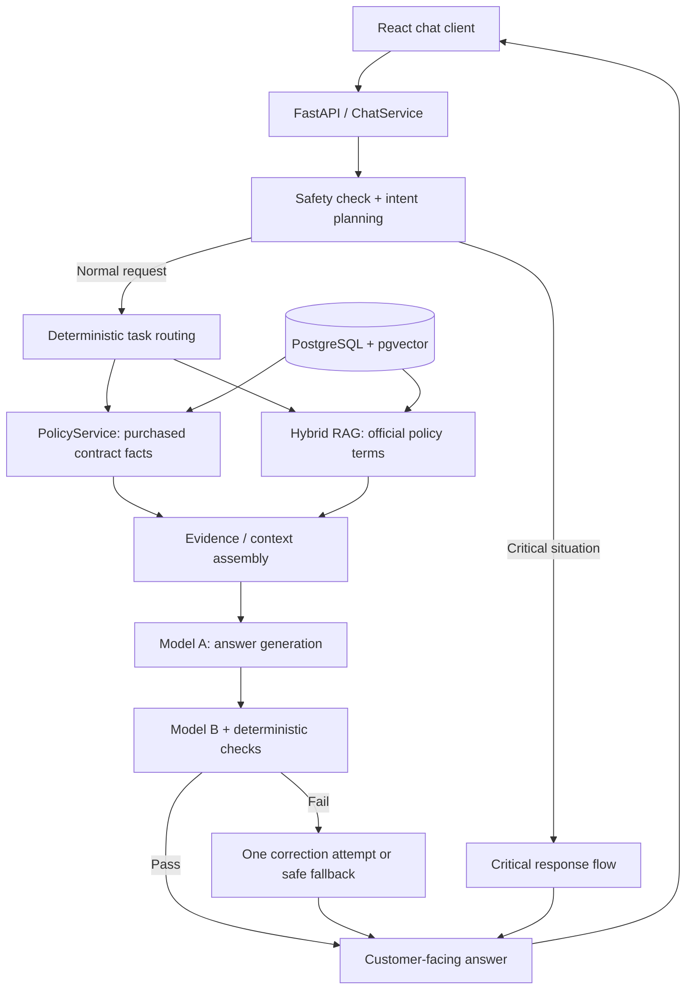

# Good AI Advisor

**An evidence-grounded AI assistant for travel insurance.**

Good AI Advisor is a portfolio and research prototype that helps a policyholder understand **what they purchased** and **what the applicable insurance terms say**. It combines structured contract data with hybrid retrieval over policy documents, then checks generated answers against the evidence before returning them.

> **Scope:** Technical demonstration using synthetic customer data. Not insurance advice or a production-ready insurance system.

## Why this project exists

Consider a customer asking:

> **“My baggage was stolen from a car. Am I covered?”**

A generic chatbot could give a confident but incorrect answer. To respond responsibly, this assistant must establish three different things:

1. **Customer-specific facts:** Does this policy include baggage coverage? What are its dates and limits?
2. **Contractual conditions:** What do the relevant insurance terms say about theft from a vehicle, storage, and exclusions?
3. **Evidence sufficiency:** Is there enough information about this particular incident to give a definite answer, or should the assistant ask for details?

This is why the project separates **intent understanding**, **controlled data access**, **document retrieval**, **answer generation**, and **independent answer validation**. Each layer has one responsibility; the LLM does not choose arbitrary database queries or decide which services it may access.

## System architecture



**The main design principle:** AI interprets a question; backend rules control execution; trusted sources provide evidence; a separate validation step decides whether generated claims are supported.

There are deliberate shortcuts. A broad **recorded-policy overview** can be rendered from validated contract facts using a deterministic template, without answer-generation or semantic-validation calls. A clarification or critical situation may also terminate the ordinary flow early. The diagram above describes the normal **generated-answer path**, not every possible branch.

### Why the components are separate

| Layer | Responsibility |
| --- | --- |
| Safety classifier + router | Recognize critical situations and select a controlled response path; **not** authentication or authorization. |
| Query planner | Identify user intent and produce typed tasks. |
| Task router | Deterministically map tasks to approved sources; the LLM cannot freely execute tools. |
| PolicyService | Read the customer's own contract, coverages, dates, options, and limits after ownership checks. |
| RetrievalService | Find relevant conditions and exclusions in version-scoped insurance documentation. |
| Model A | Explain retrieved evidence and structured policy facts in natural language. |
| Model B + backend guards | Check material claims against source evidence; accept, regenerate once, or use a safe fallback. |

**Examples of routing:**

| Customer question | Required evidence |
| --- | --- |
| “When does my insurance expire?” | **POLICY** — the recorded end date. |
| “What documents are needed for a baggage claim?” | **RETRIEVAL** — claim procedures in the policy terms. |
| “Is theft of baggage from my car covered?” | **POLICY + RETRIEVAL** — purchased coverage **and** applicable conditions. |

## How the RAG retrieval works

```text
User question
    ├─ E5 semantic search + pgvector       (top 20)
    ├─ Original lexical search + pg_trgm   (top 20)
    └─ Stanza-assisted lexical search      (top 20)
                    ↓
             RRF rank fusion
                    ↓
         Up to 12 protected candidates
                    ↓
          CrossEncoder reranking
                    ↓
        Top 5 chunks + source metadata
```

Document ingestion is separate from chat: policy text is split into **article-preserving, token-bounded chunks**, embedded, and saved in PostgreSQL. At request time the system embeds the **question**, retrieves and reranks already-indexed chunks, and limits retrieval to the relevant **product version**.

For the complete implementation and experimental history, see [retrieval pipeline notes](server/docs/retrieval-pipeline.md). Some sections document earlier experiments rather than the latest runtime settings; the source code is authoritative for current configuration.

## An example request, end to end

For **“My baggage was stolen from a car. Am I covered?”**:

1. Safety and intent processing classify the request as a **coverage check**.
2. The backend retrieves the user's purchased baggage coverage and applicable contract dates.
3. Hybrid RAG retrieves relevant vehicle-theft conditions from the policy documents.
4. Model A receives those facts and excerpts. It should **not** infer eligibility just because a baggage option was purchased.
5. Model B checks factual claims against the same trusted source results, while backend guards enforce structural rules.
6. If facts such as the theft date or how the baggage was secured are missing, the answer should state the uncertainty and request the missing details instead of guaranteeing reimbursement.

See [detailed runtime flow](server/docs/architecture/ai_insurance_advisor_runtime_flow.md) and [response validation design](server/docs/architecture/response-validator-architecture-current.md) for class-level details. Those documents include historical design discussion; the high-level description here reflects the current intended behavior.

## Evaluation and performance

The project includes a **26-question Czech retrieval evaluation** with article-level reference labels, plus a separate **22-scenario AI evaluation dataset** for chat behavior and validator decisions.

| Metric | Reported local retrieval run (26 questions) |
| --- | ---: |
| Hit@1 | 69.23% (18/26) |
| Hit@3 | 84.62% (22/26) |
| Hit@5 | 100% (26/26) |
| Mean reciprocal rank (MRR) | 0.8038 |

These are results from one locally reported evaluation run, **not** an independently reproduced or production accuracy claim. They measure whether at least one expected **article** is retrieved; they do not prove that all required insurance conditions are present or that the final answer is correct. The reported retrieval time for one query was **1.315 seconds**; it is not the mean across the dataset or the full chat response time.

Run the evaluation from `server`:

```powershell
python -m scripts.run_retrieval_eval
python -m scripts.test_retrieval_latency
python -m scripts.run_ai_eval --check
```

Read [interactive chat latency](server/docs/chat-latency.md) for measured request scenarios and the distinction between template and generated-answer paths.

## Security and project boundaries

This prototype **does not implement production authentication**. In explicit `ENVIRONMENT=development`, the server selects a configured synthetic user; the client cannot supply arbitrary user identity. Policy and conversation ownership checks are enforced. Outside development, protected endpoints reject access until production authentication is implemented.

The assistant also applies separate **AI-safety controls**: critical-situation routing, source-grounding validation, controlled retries, and safe fallback responses. These are **not substitutes for** authentication, authorization, privacy controls, or security testing. Runtime diagnostics avoid printing message content and other sensitive response data; deployment access-log configuration remains a separate concern.

Future security work includes real authentication, threat modeling, prompt-injection tests, privacy and retention policies, and broader operational monitoring. This repository should be used with **synthetic data only**.

## Data model

The PostgreSQL schema models users, insured people, policies, coverages, selected options, product/document versions, document chunks, and conversations.


## Tech stack

- **Frontend:** React, TypeScript, Vite
- **Backend:** Python, FastAPI, SQLAlchemy, Alembic, Pydantic
- **Data and retrieval:** PostgreSQL, pgvector, `pg_trgm`, multilingual E5, Stanza, CrossEncoder
- **LLM providers:** Groq or Gemini (configurable)
- **Testing and infrastructure:** pytest, Docker Compose

## Repository layout

```text
good-ai-advisor/
├── server/
│   ├── app/                 # API, domain services, models and repositories
│   ├── data/                # Synthetic fixtures, policy material and eval datasets
│   ├── docs/                # Detailed architecture and experiment notes
│   ├── migrations/          # Alembic migrations
│   ├── scripts/             # Ingestion, seeding and evaluation
│   └── tests/               # Backend tests
├── ui/                      # React client
├── docker-compose.yml      # Local PostgreSQL + pgvector
└── README.md
```

## Run locally

**Prerequisites:** Python 3.11+, Node.js 20+, Docker Desktop and a configured Groq or Gemini API key.

1. Start PostgreSQL from the repository root:

   ```powershell
   docker compose up -d
   ```

2. Configure the API from `server`:

   ```powershell
   cd server
   Copy-Item .env.example .env
   python -m venv .venv
   .\.venv\Scripts\Activate.ps1
   pip install -r requirements-dev.txt
   alembic upgrade head
   python -m scripts.seed_dev
   ```

   In `server/.env`, set `ENVIRONMENT=development`, `LLM_PROVIDER=groq` or `LLM_PROVIDER=gemini`, and the matching provider API key. Copy `DEV_USER_ID` and `DEV_POLICY_ID` printed by seeding into `.env`. The demo identity is not authentication and must never be used with real customer data.

3. Prepare and index the insurance documents:

   ```powershell
   python -m scripts.validate_chunking
   python -m scripts.ingest_vpp_cp_2021
   python -m scripts.check_demo_setup
   ```

   Ingestion processes the included structured JSON derived from the source policy PDF. Re-ingestion **replaces existing chunks** for the chosen document; use a disposable development database when experimenting. If you have multiple versions, specify `--product-version-id <UUID>` where required.

4. Start the backend:

   ```powershell
   uvicorn app.main:app --reload
   ```

   API: `http://localhost:8000` · OpenAPI docs: `http://localhost:8000/docs`.

5. Start the frontend from the repository root in a separate terminal:

   ```powershell
   cd ui
   Copy-Item .env.example .env
   npm install
   npm run dev
   ```

   Open `http://localhost:5173` and start a new conversation. A synthetic development policy is used; the UI does **not** select a user identity.

**Run tests** from `server`:

```powershell
python -m pytest tests app/services/test
```

The seeded database integration test requires a properly initialized local database. For a reproducibility check, test migrations, seed data and ingestion on a fresh demo database, not only on an already populated one.

## Current limitations and planned improvements

- Production authentication and deployment hardening are not yet implemented.
- Retrieval evaluation uses a small, article-labelled dataset; independent label review and end-to-end answer-quality evaluation are still needed.
- A hosted demo, automated CI and broader integration/security tests remain future work.

This project prioritizes **traceable evidence, explicit backend decisions and honest uncertainty** over producing a confident answer for every question.
