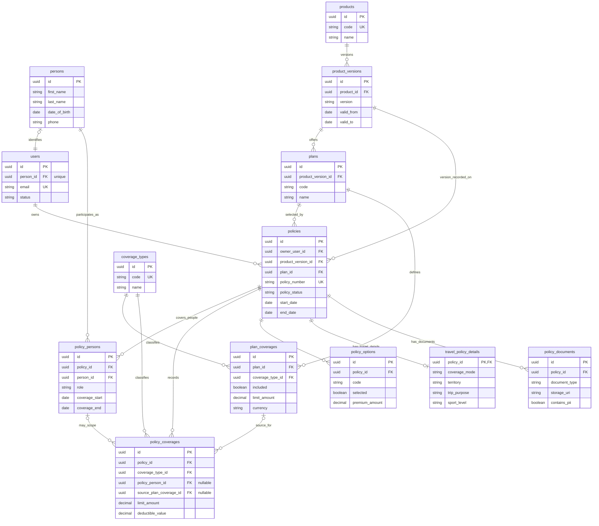
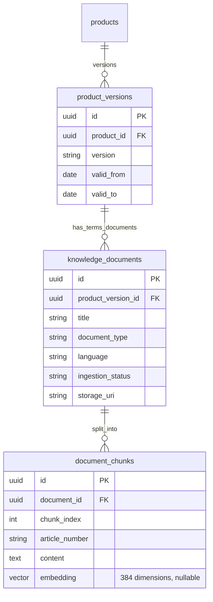
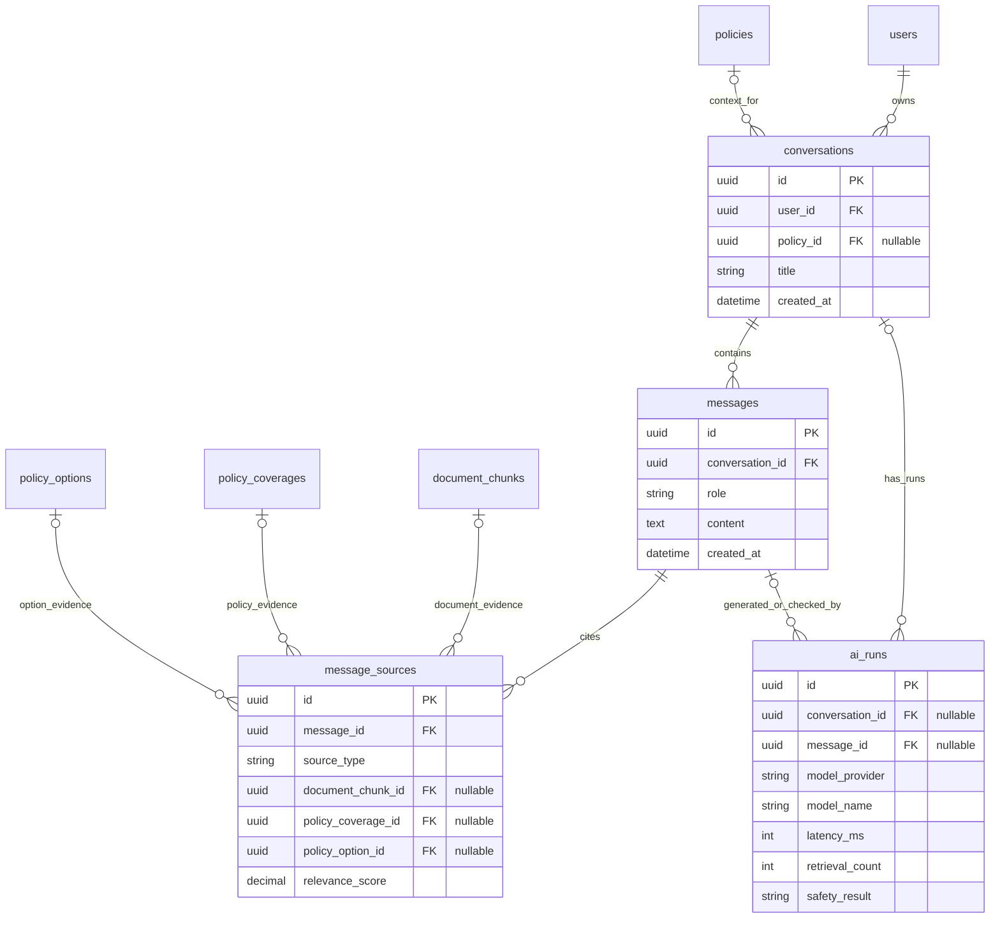

# Good AI Advisor data model ERD

This page maps the current SQLAlchemy data model into three views: the insurance contract and product catalogue, the document retrieval corpus, and chat evidence/audit records. It is based on `server/app/models/`; each entity shows the main identifiers and relationships rather than every implementation column.

## 1. Policy and product catalogue

A policy belongs to a user, selects a plan and product version, and stores policy-level coverage records. `PolicyPerson` links people to policies with a role and optional coverage dates.

### Coverage interpretation

`PlanCoverage` is the reusable catalogue definition. `PolicyCoverage` is the coverage recorded on a specific purchased policy, with its own limit/deductible fields and an optional `source_plan_coverage_id` for provenance. That link does not mean the policy reads the plan row's values dynamically. If policy records are copied from the plan, application logic should validate the copy and explicitly handle approved overrides.

## 2. Product documents and retrieval chunks

Insurance wording is attached to a product version. Each document is split into chunks; chunks store text and an optional vector embedding used by retrieval.

## 3. Conversations, sources, and AI run records

A conversation belongs to a user and may be associated with a policy. Messages belong to conversations. Message sources preserve links to evidence used in answers, while AI runs keep execution metadata.

## Notes for reading

- `users.person_id` is unique and required, so each user maps to one person; a person can exist without a user account.
- The model has separate `policies.plan_id` and `policies.product_version_id` foreign keys. The ERD shows both as stored; it does not imply the database alone guarantees the chosen plan belongs to that product version.
- A nullable `message_sources` evidence foreign key means source rows may represent one of several evidence kinds. The model layer should validate that each source row is internally consistent.
- `PolicyDocument` represents a document attached to a customer's policy. `KnowledgeDocument` represents product wording used for retrieval; these are separate document purposes.
