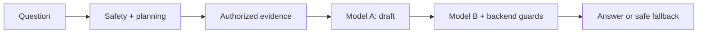

# Security & Safety — Good AI Advisor

**Status:** Local portfolio/research prototype, not production-ready. The project currently uses synthetic customer data. This document distinguishes **implemented controls**, **known limitations**, and **planned safeguards**.

> **Key distinction:** Application security controls *who can access data*; AI safety controls *what the assistant is allowed to say*. A safety classifier or response validator does not replace authentication, authorization, or privacy protection.

## 1. Security boundaries at a glance

| Area | Current approach | Status |
| --- | --- | --- |
| User identity | Server-configured development user; no user ID accepted in the chat payload | **Development only** |
| Policy access | Check that the selected policy belongs to the current user | **Implemented** |
| Conversation access | Check conversation ownership and preserve its associated policy | **Implemented** |
| Document scope | Retrieve insurance terms only for the product version of the authorized policy | **Implemented** |
| Critical situations | Safety classification routes urgent situations to a deterministic response | **Implemented (LLM-based classification)** |
| Grounded answers | Model B checks generated claims against evidence; backend applies guards and a bounded retry | **Implemented** |
| Prompt-injection defense | Trusted source separation and generation instructions; no comprehensive injection defense established | **Partial / requires testing** |
| Production authentication | OIDC/session or token authentication | **Not implemented** |
| Deployment/privacy hardening | TLS, secrets management, data retention, rate limits, monitoring, independent security tests | **Not established / planned** |

## 2. How access is controlled today

**Local development identity.** When `ENVIRONMENT=development`, `get_current_user` loads the configured `DEV_USER_ID` from PostgreSQL and requires an `ACTIVE` user. The chat request schema forbids extra fields, including a client-supplied `user_id`; the dependency also rejects a `user_id` query parameter. A missing or invalid demo identity prevents access.

**Outside development, protected API endpoints return `401`**, because production authentication has not yet been implemented. The default environment is `production`, not `development`. Everyone who can access a running development API acts as the same configured demo user: **do not expose this mode publicly or use real customer data**.

**Ownership checks.** Policy endpoints read data through `PolicyService` using `owner_user_id`. Conversation continuation must belong to the user, must keep its original policy, and rechecks policy ownership before retrieving chat history or saving another message. An unauthorized or nonexistent policy/conversation is not exposed to that caller.

**Retrieval isolation.** The retrieval route resolves `product_version_id` from the policy after checking ownership; it does not take an arbitrary version from the LLM. Semantic and lexical searches filter to documents belonging to that version and marked `READY`. This is **product/version scoping**, not an independent document-level access-control system.

Relevant implementation: [`identity.py`](../app/core/identity.py), [`policy_service.py`](../app/services/policy_service.py), [`conversation_service.py`](../app/services/conversation_service.py), [`chat_service.py`](../app/services/chat_service.py), [`document_chunk_repository.py`](../app/repositories/document_chunk_repository.py).

## 3. AI-safety behavior

The normal generated-answer path is deliberately controlled:

- **Safety check:** `SafetyClassifier` evaluates whether the **current** user situation appears medically, personally, legally, or otherwise urgent. A critical result goes to `CriticalFlowService`, which returns a predefined response instead of proceeding through the normal insurance-answer path. Planning may start concurrently, but its work is discarded if the request is critical.
- **Intent and routing:** `QueryPlanner` produces typed tasks. `TaskRouter` deterministically maps them to `POLICY`, `RETRIEVAL`, or both. The model cannot choose arbitrary backend tools or SQL queries.
- **Evidence-based generation:** Model A receives structured policy facts and/or retrieved document excerpts. Its instructions explicitly prohibit inventing coverages, limits, exclusions, or claim approval, and require conditions and uncertainty to be explained.
- **Independent output check:** `ResponseValidator` applies deterministic guards, builds evidence from the same structured `TaskResult[]`, and invokes Model B (`GroundingValidator`) for generated answers. Supported claims must reference known evidence IDs; invented IDs and malformed results fail validation.
- **Bounded regeneration:** An unsupported or contradicted draft can be regenerated **once**. A second failure, missing required evidence, or a validator error leads to a safe response rather than an unverified insurance assertion.
- **Special cases:** A clarification can be returned before retrieving data. A narrowly defined *recorded-policy overview* is rendered directly from authorized structured records without Model A or Model B; it is not a decision on whether a specific claim is covered.

These are safeguards, **not a guarantee that every statement is correct**. Both model-based classification and grounding can make errors, and retrieved excerpts may omit important conditions.

## 4. What the user receives

| Situation | Current API / assistant behavior | User-visible effect |
| --- | --- | --- |
| Request without authentication outside development | `401` on protected endpoints | The API denies access; frontend presentation depends on UI handling |
| Client sends `user_id` in chat body | `422` schema validation error | The request is rejected |
| Client sends `user_id` as query parameter | `400` | The request is rejected |
| Missing/inactive development user | `401` (or `503` for invalid demo configuration) | The request cannot proceed |
| Foreign or missing policy via policy API, or foreign/missing conversation | `404` | No private policy/conversation details are returned |
| Policy inaccessible while processing an authorized conversation | Safe policy-unavailable message | No coverage conclusion is given |
| Current critical situation | Predefined `CriticalFlowService` message (currently Czech wording) | Guidance prioritizes immediate help over policy interpretation |
| Ambiguous insurance question | Planner's clarification question | User is asked for missing details |
| Missing trusted answer context | Insufficient-information response | No unsupported answer is generated |
| Unsupported/contradicted generated claim | One regeneration attempt, then safe fallback if still invalid | Unverified claim is not intentionally released |
| Model B error or evidence-check failure | `HANDOFF` / `REJECT` safe message | User is directed to the policy documents or support |
| Unexpected server exception in chat endpoint | Generic `503` | Internal exception details are not returned by that route |

**Important:** `HANDOFF` is currently a **fallback message**, *not* an automatically created support ticket or live-agent transfer. Likewise, the critical-flow response is a fixed message, not an emergency-service integration.

## 5. Data handling and privacy

- Chat history, assistant messages, source references, and AI-run metadata are persisted in PostgreSQL for the prototype. Retrieval chunks and embeddings are stored in PostgreSQL/pgvector.
- Model A and Model B receive evidence and user questions through the configured LLM provider (Groq or Gemini). **Do not assume the deployment is private or that third-party data processing has been approved.** The local embedding/reranking models are a separate part of the stack.
- Application logging has been reduced to avoid printing user messages, conversation history, retrieved context, answers, and identity values in common paths. This is not proof that **all** logs, reverse proxies, database traces, or external-provider telemetry are free of sensitive information.
- API/CORS settings currently target local development origins. CORS is **not** an authentication or authorization control.
- Encryption at rest, transport configuration in deployment, backup access, deletion/retention schedules, and incident response are **not documented as implemented**.

## 6. Known risks and production roadmap

**Before public deployment or real customer data:**

1. **Authentication and authorization:** Implement a real identity provider (for example OIDC), user sessions/tokens, consistent access checks on every protected resource, and multi-user isolation tests. Remove the shared demo identity from deployable environments.
2. **Privacy and infrastructure:** Enforce HTTPS/TLS, secrets management and key rotation, least-privilege database credentials, appropriate encryption, retention/deletion rules, secure backups, and access-log redaction. Review contractual/data-protection requirements for the selected LLM provider.
3. **API abuse protection:** Add rate limits, request-size and cost controls, timeouts, structured error handling, and monitoring/alerting. Do not expose diagnostic LLM endpoints in a production deployment without appropriate controls.
4. **Prompt-injection resilience:** Treat user text, conversation history, and retrieved document content as untrusted instructions. Test attempts to override system rules, request another user's data, fabricate evidence, or induce coverage guarantees. Add defenses based on measured failure cases; prompts alone are insufficient.
5. **Independent validation:** Expand security and AI-safety evaluation beyond mocked tests, including access-control integration tests, unsafe-acceptance rates, emergency-classification errors, grounding false accepts, and provider-failure scenarios.
6. **Human escalation:** If a real handoff feature is required, specify support integration, audit trail, consent, and user messaging; do not describe the current fallback string as a completed workflow.

## 7. Testing and scope of assurance

The repository includes regression tests such as [`test_identity_access.py`](../tests/services/test_identity_access.py) for development identity, ownership boundaries, and sensitive-data logging, plus AI validation tests under [`app/services/test`](../app/services/test/). These are useful checks but do **not** constitute a penetration test, a production authorization audit, or a guarantee of reliable model behavior.

For an end-to-end request example, see [Request Lifecycle](REQUEST_LIFECYCLE.md). For the broader component map, see [Architecture](ARCHITECTURE.md). For current audit notes, see [audit progress](audit-progress.md).
