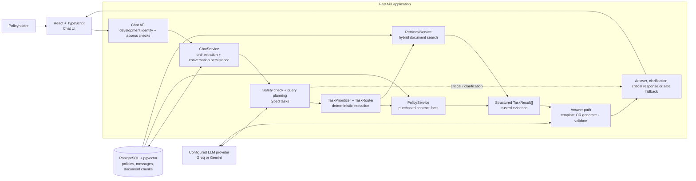
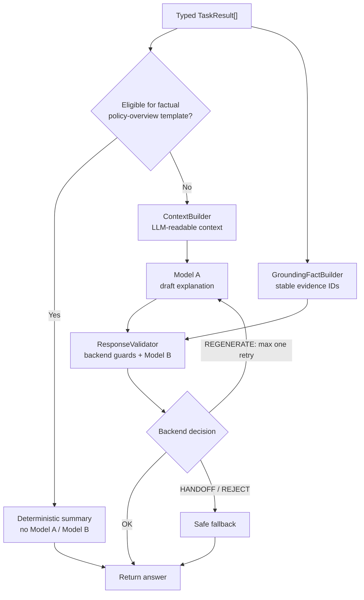

# Good AI Advisor — System Architecture

> **Status:** As implemented in the current prototype. This is a high-level system view, not a class diagram or a production deployment design.

Good AI Advisor answers travel-insurance questions by combining **customer-specific policy records** with **official insurance documentation**. Its architecture deliberately separates understanding a question, fetching authorized information, generating an explanation, and checking its factual support.

**Core design principle:** The LLM interprets intent and drafts explanations; deterministic backend code controls which data sources are accessed and which responses can be released.

## 1. System at a glance



**How to read the diagram:** This is a logical component map. The database is a single PostgreSQL instance with structured policy and conversation tables plus document chunks and vector embeddings. The configured LLM provider is external to the application. The dashed arrow represents an early exit: critical situations or clarification requests do not need the normal evidence-generation path.

### Why these components exist

| Group | Responsibility | Why it matters |
| --- | --- | --- |
| **Chat API and identity boundary** | Accept the request, obtain a server-controlled development identity, and enforce access restrictions. | The client must not select an arbitrary customer identity. Production authentication is **not implemented**. |
| **ChatService / conversation** | Load recent history, coordinate each stage, and persist messages, source references, and AI-run metadata. | Follow-up questions retain context and execution can be audited. |
| **Safety classifier and router** | Detect critical situations and choose the critical or normal flow. | An emergency should not be answered as an ordinary coverage question. This is **AI safety**, not authentication. |
| **QueryPlanner and TaskRouter** | The planner produces typed tasks; backend rules select approved services. | An LLM does **not** write arbitrary SQL or dynamically choose tools. |
| **PolicyService** | Read the authorized customer's recorded policy, coverages, limits, dates, options, and travel details. | Determines **what the customer bought**. |
| **RetrievalService** | Search the official terms associated with the policy's product version. | Determines **what the insurance documents say**, including conditions and exclusions. |
| **Response path** | Render a narrow factual template, or generate and validate a contextual answer. | Straightforward recorded-policy overviews avoid unnecessary generation; other answers are checked against trusted evidence. |

## 2. Which evidence is retrieved?

`TaskRouter` maps planner output to approved data targets:

| Request type | Data target(s) | Example |
| --- | --- | --- |
| `POLICY_DETAILS` | `POLICY` | “When does my insurance expire?” |
| `PROCEDURE` | `RETRIEVAL` | “What documents are needed for a baggage claim?” |
| `GENERAL_QUESTION` | `RETRIEVAL` | “What does the policy mean by a deductible?” |
| `COVERAGE_CHECK` | `POLICY` + `RETRIEVAL` | “Is my baggage covered if stolen from a car?” |

Even `RETRIEVAL`-only tasks are **product-version scoped**: the application resolves the applicable version from an authorized policy before searching documents. It does not search across unrelated customer products or insurance terms.

The data sources are complementary, not interchangeable:

- **Policy facts** establish the actual purchased product, coverage selections, dates and limits.
- **Retrieved clauses** establish contractual definitions, conditions, exceptions and procedures.
- **Incident details** must still be supplied by the user; neither source proves an event happened or that every condition was met.

## 3. How an answer is produced



Two representations are deliberately derived from the **same structured service results**:

- `ContextBuilder` turns policy data and retrieved excerpts into readable context for **Model A**, which creates the draft answer.
- `GroundingFactBuilder` preserves evidence identity for **Model B**, which checks whether material claims are supported by that evidence.

`ResponseValidator` also runs deterministic backend guards. It can **skip Model B** when trusted evidence is missing or another blocking invariant fails; in that case, a generated answer is not approved. Unsupported or contradicted claims may trigger **one** correction attempt, after which failure produces a safe fallback. The validator does not make a fresh coverage decision from general model knowledge.

The factual template path is intentionally narrow: a qualifying broad overview of the *recorded* policy. It must not be used to decide whether a particular claim is covered.

## 4. Hybrid RAG: indexing vs. question-time retrieval

**Document ingestion (offline, not part of `/chat` latency):**

```text
Prepared structured policy document (VPP)
    → preserve article boundaries and split into <= 400-token chunks
    → add document / article context for embedding
    → multilingual E5 document embeddings
    → store chunks, metadata and vectors in PostgreSQL
```

**Retrieval (at question time):**

```text
Question
    ├── E5 embedding + pgvector semantic search       (top 20)
    ├── Original lexical search with PostgreSQL pg_trgm (top 20)
    └── Stanza-assisted lexical search                  (top 20)
                     ↓
               RRF rank fusion
                     ↓
         Protected candidates (maximum 16)
                     ↓
              CrossEncoder reranker
                     ↓
          Top 5 article chunks + metadata
                     ↓
                Typed TaskResult
```

Both semantic and lexical retrieval operate within the applicable product-version scope. The ranking pipeline uses the stored document embeddings; it does **not** re-embed the entire source document for each question. Embedding and reranker models are initialized at application startup and reused.

For retrieval experiments and evaluation, see [Retrieval Pipeline](retrieval-pipeline.md) and the dataset at [`server/data/evals/retrieval_eval.json`](../data/evals/retrieval_eval.json). Historical experiments may describe older configurations; the running service is authoritative for current limits.

## 5. Trust boundaries and known limitations

- **Identity and authorization:** The current local demo uses server-configured synthetic identity, checks policy ownership and rejects protected requests outside development until production authentication exists. This is **not** a complete login or authorization system.
- **LLM authority:** The planner can classify a question but cannot issue unrestricted queries or select arbitrary runtime tools; backend routing and access checks govern data retrieval.
- **Evidence sufficiency:** Returning five chunks does not prove that the necessary clauses were all retrieved. The assistant must qualify uncertain claims and may ask for missing incident details.
- **Answer validation:** Model B is a separate checking responsibility, not a guarantee of factual correctness. Backend guards and safe fallbacks limit failures; independent evaluation is still required.
- **External processing:** The configured Groq or Gemini provider handles LLM requests; a production privacy and data-handling design is future work. Only synthetic data should be used in this demo.

## 6. Reading guide

- [Project README](../../README.md) — problem statement, capabilities and quickstart
- [Detailed runtime flow](architecture/ai_insurance_advisor_runtime_flow.md) — class-level responsibilities and examples (includes historical design discussion)
- [Response validation design](architecture/response-validator-architecture-current.md) — Model A / Model B evidence checking (contains historical proposals)
- [Retrieval pipeline](retrieval-pipeline.md) — experiments, ranking decisions and evaluation
- [Chat latency](chat-latency.md) — fast template path, provider timings and benchmarking limits

**Data model vs. system architecture:** The entity-relationship diagram in the README shows **how records relate in the database**. The diagrams here show **how application components collaborate at runtime**. They answer different questions.

A single detailed, evidence-backed coverage-check request will be documented separately as the next step (`REQUEST_LIFECYCLE.md`).
