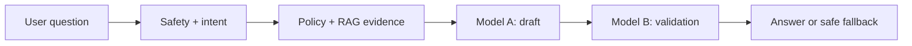
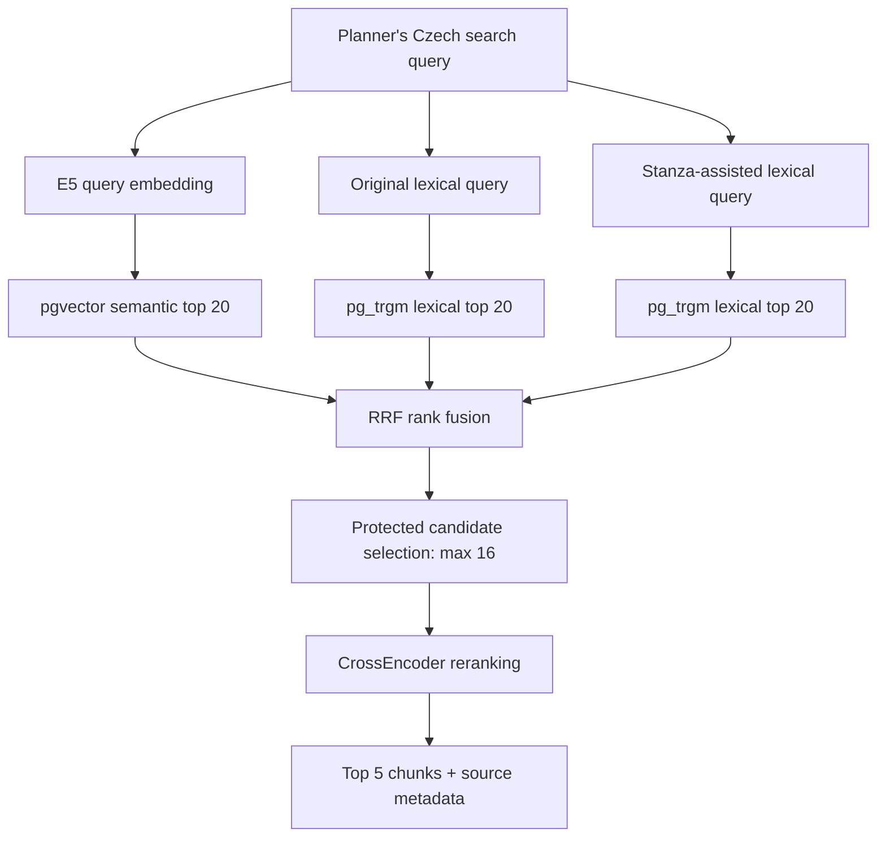

# Request lifecycle — from a customer question to a grounded answer

> **Good AI Advisor · Implementation walkthrough**  
> This document describes the current backend behavior and explains *why* each stage exists. It is intended for engineers seeing the project for the first time. See the [project overview](../../README.md) for the broader product and architecture context.
>
> **Example data below is illustrative**, not a captured production response, actual retrieval ranking, or a verified insurance coverage determination. The project runs with synthetic development data and does not implement production authentication.

## The question we need to answer

A policyholder asks:

> **“My baggage was stolen from a car. Am I covered?”**

This is harder than a generic question about baggage insurance. It requires two independent information sources:

| Source of truth | What it can establish | What it cannot establish alone |
| --- | --- | --- |
| **Customer policy (`POLICY`)** | Purchased coverages, policy dates, limits, options and other recorded terms | Whether every condition of this particular theft is satisfied |
| **Insurance terms (`RETRIEVAL`)** | Relevant definitions, vehicle-storage conditions, limitations and exclusions | Which coverage/options the customer actually bought or what happened in this incident |

The incident date, whether the vehicle was locked, and how the baggage was stored may still be unknown. **A purchased baggage benefit does not mean this incident is automatically covered.**

## Request at a glance



This is deliberately a simplified view. `ChatService` orchestrates the stages: safety and planning begin concurrently, but **policy and retrieval tasks run only after safety approval**. A backend router selects `POLICY`, `RETRIEVAL`, or both. Model B checks generated claims against the retrieved evidence; the backend can approve, retry generation once, or return a safe fallback. For critical requests, clarifications, and factual policy overviews, the flow may end earlier.

## Step 1 — Receive the request and resolve the conversation

**Code:** `app/api/chat.py`, `app/core/identity.py`, `app/services/conversation_service.py`, `app/services/chat_service.py`

The UI calls `POST /chat` with a message and optional `conversation_id` / `policy_id`:

```json
{
  "message": "My baggage was stolen from a car. Am I covered?",
  "conversation_id": null,
  "policy_id": null
}
```

In **development mode**, the API uses a *server-configured* synthetic user; for a new conversation it can also use the configured demo policy. The client cannot select its own user identity. The conversation and chosen policy must belong to that user. An existing conversation keeps its original policy; the service loads recent messages, then records the current user message.

**Why this stage exists:** It establishes the relevant customer contract and conversation context without trusting an arbitrary user ID supplied by the LLM or client. **This is not production authentication.**

## Step 2 — Safety classification and intent planning

**Code:** `app/services/chat_service.py::_prepare_turn`, `app/services/safety_classifier.py`, `app/services/query_planner.py`

Two LLM-assisted operations **start concurrently** to reduce waiting time:

1. `SafetyClassifier` decides whether the message indicates a critical situation. `SafetyRouter` chooses `CRITICAL_FLOW` or `NORMAL_FLOW` deterministically.
2. `QueryPlanner` analyzes the current question and recent history. Its output is a typed `QueryPlan`, not executable SQL or unrestricted tool calls.

No planned policy or retrieval task is executed before the safety result permits the normal flow. In a critical case, pending planning is canceled and a controlled critical response is used.

### Representative `QueryPlan`

The *possible* structured output for our sample question looks like this (not a recorded trace):

```json
{
  "action": "EXECUTE",
  "tasks": [
    {
      "type": "COVERAGE_CHECK",
      "query": "Vztahuje se cestovní pojištění na odcizení zavazadel z automobilu?",
      "evidence": "My baggage was stolen from a car. Am I covered?",
      "policy_overview_language": null
    }
  ],
  "clarification_question": null
}
```

**Why the query is in Czech:** The configured document corpus is Czech (`RETRIEVAL_QUERY_LANGUAGE`). The planner is instructed to translate `task.query` faithfully for retrieval, while `task.evidence` must come from the user's *current* message. Conversation history helps interpret references such as “its limit”; it is **not trusted policy evidence**. The final answer can still be in English.

## Step 3 — Deterministic routing, not LLM-selected services

**Code:** `app/services/task_prioritizer.py`, `app/services/task_router.py`

The planner proposes a task **type**. Backend Python code maps that type to approved targets:

| Task type | Target(s) | Typical use |
| --- | --- | --- |
| `POLICY_DETAILS` | `POLICY` | Policy dates, selected options, limits |
| `GENERAL_QUESTION` | `RETRIEVAL` | Insurance terms and definitions |
| `PROCEDURE` | `RETRIEVAL` | Claim reporting requirements |
| **`COVERAGE_CHECK`** | **`POLICY` + `RETRIEVAL`** | Apply documented conditions to a purchased contract |

`TaskPrioritizer` orders tasks, and `TaskRouter` chooses the targets. Neither calls an LLM. For this question, the backend needs **both** sources. They are executed in the task loop; the two targets are not automatically parallelized.

**Why this stage exists:** Model output cannot directly decide which database operations or services to execute. The mapping is reviewable and testable.

## Step 4 — Read the customer's actual policy

**Code:** `app/services/policy_service.py`, `app/services/chat_service.py`

`PolicyService` reads the owned contract from PostgreSQL. The resulting structured `PolicyTaskContent` can include:

```text
PolicyTaskContent
├── policy: id, status, payment status, start/end dates
├── coverages: names, codes, limits and currencies
├── options: selected flags and variants
├── people: insured roles
└── travel_details: territory, destination, sports level, etc.
```

This is wrapped as `TaskResult(task_type=COVERAGE_CHECK, target=POLICY, content=...)`.

**Important:** `policy_status=ACTIVE` is a recorded database status. It is **not** proof the insurance applied on the theft date. Date and incident details must be evaluated separately.

## Step 5 — Find the applicable insurance conditions with Hybrid RAG

**Code:** `app/services/retrieval_service.py`, `app/repositories/document_chunk_repository.py`, `app/services/reranker_service.py`

First, the backend obtains `product_version_id` from the **authorized policy**. The LLM does not pick the insurance product version. Retrieval is scoped to that version and READY knowledge documents.



- **Semantic retrieval** (`intfloat/multilingual-e5-small` + pgvector) finds related meaning.
- **Original lexical retrieval** (`pg_trgm`, `unaccent`) preserves matches on insurance terminology.
- **Stanza-assisted lexical retrieval** expands/rephrases the Czech query for another lexical search.
- **RRF** combines rankings without directly mixing incompatible score scales.
- **Candidate protection** retains strong hits from each source, up to **16** unique candidates.
- **CrossEncoder** (`cross-encoder/mmarco-mMiniLMv2-L12-H384-v1`) reranks query–chunk pairs; the final answer context receives up to **5** chunks. Reranker scores are not coverage probabilities.

The chunks are already indexed before chat. The ingestion script creates article-preserving, token-bounded chunks and stored E5 embeddings. It also adds section context to the text used for embeddings. **Chat-time retrieval does not reprocess the PDF or re-embed every document.**

The result becomes a `TaskResult(target=RETRIEVAL, content=RetrievalTaskContent(chunks=[...]))` with chunk IDs, source document IDs, sections, article/page metadata, content, and scores. A retrieved article may discuss conditions for theft from a vehicle; retrieval **does not decide whether this specific event is covered**.

## Step 6 — Build trusted evidence for two different purposes

**Code:** `app/services/context_builder.py`, `app/services/grounding_fact_builder.py`, `app/schemas/task_result.py`

The two services consume the same structured `TaskResult[]`, but **they produce different representations**:

```text
           TaskResult(POLICY) + TaskResult(RETRIEVAL)
                            |
                  +---------+---------+
                  |                   |
            ContextBuilder     GroundingFactBuilder
                  |                   |
         [POLICY FACTS]         GroundingFact(id, text)
         [INSURANCE DOCS]       Stable policy / chunk IDs
                  |                   |
               Model A              Model B
```

`ContextBuilder` formats policy facts and retrieved chunks into an LLM-readable context. `GroundingFactBuilder` creates traceable facts such as:

```text
policy:<policy-uuid>:end_date
policy.coverage:<coverage-uuid>
document.chunk:<chunk-uuid>
```

These IDs point back to known backend objects. The builders do **not** query the database again, and Model B does **not** derive its evidence by parsing Model A's draft.

## Step 7 — Generate a cautious answer (Model A)

**Code:** `app/prompts/answer_generation.py`, `app/services/chat_context.py`, `app/services/chat_service.py::_generate_validated_answer`

Model A receives:

```text
System instructions: use only trusted sources, do not guarantee claim payment
+ Current user question
+ Recent conversation history (interpretation only)
+ ContextBuilder output:
    [POLICY FACTS] purchased coverages, dates, options ...
    [INSURANCE DOCUMENTATION] retrieved clauses and source references ...
```

For our scenario, an **appropriate hypothetical draft** could say:

> “Your policy records include baggage coverage, but I can't confirm whether this theft is covered from the information provided. The policy terms contain conditions about theft from vehicles. When did the theft occur, was the vehicle locked, and where was the baggage stored?”

This is deliberately **conditional**. It is not a claim that the actual customer's policy includes baggage coverage, nor a statement that a specific clause guarantees payment. The complete terms and incident facts matter.

## Step 8 — Verify claims before releasing the answer (Model B)

**Code:** `app/services/response_validator.py`, `app/services/grounding_validator.py`, `app/services/validation_decision_policy.py`

The validation path is:

1. **Deterministic guards** check hard constraints, including nonempty output and required trusted sources. A `COVERAGE_CHECK` needs both `POLICY` and `RETRIEVAL` results.
2. **GroundingFactBuilder** turns source results into facts carrying evidence IDs.
3. **Model B** checks *material factual claims* in the draft against those facts and returns a structured verdict (`SUPPORTED`, `UNSUPPORTED`, or `CONTRADICTED`) with claim-level evidence IDs.
4. **Python validates the structured result and evidence IDs.** The backend's `ValidationDecisionPolicy`, not Model B directly, chooses the action.

Example of what a **supported individual claim** might look like (illustrative):

```json
{
  "claim": "The recorded policy includes baggage coverage.",
  "grounding_required": true,
  "supported": true,
  "evidence_ids": ["policy.coverage:<coverage-uuid>"],
  "score": null
}
```

`SUPPORTED` means the **answer's factual claims are supported by the supplied evidence**. It does not independently establish that the customer will receive insurance reimbursement. Source completeness and real-world facts can still be missing.

| Backend action | Meaning | What happens next |
| --- | --- | --- |
| `OK` | The draft passed required checks | Return the answer |
| `REGENERATE` | Potentially fixable unsupported/contradicted claims | Generate a corrected draft **once**, then validate again |
| `HANDOFF` | Insufficient evidence, validator failure, or exhausted retry | Return a safe fallback |
| `REJECT` | Invalid runtime state / hard failure | Do not release the draft; return a safe fallback |

There is **no unlimited regeneration loop** (`MAX_REGENERATION_ATTEMPTS = 1`). A validator timeout is a failure to validate, **not** proof that the answer is correct.

## Step 9 — Save the outcome and return it to the UI

**Code:** `app/services/chat_service.py::_save_assistant_answer`, `app/services/message_source_service.py`, `app/services/ai_run_service.py`

`ChatService` persists the assistant message, relevant source references (when task results are available), and AI-run metadata including latency and safety outcome. It returns the API response:

```json
{
  "answer": "<validated answer or safe fallback>",
  "conversation_id": "<conversation-uuid>"
}
```

The UI can reuse `conversation_id` for follow-up questions. It should not treat retrieved text or model output as an authorization mechanism.

## Other outcomes

The nine-step example is **not** a mandatory path for every question:

| Situation | What changes |
| --- | --- |
| **Critical situation** | Safety routing stops normal execution; `CriticalFlowService` supplies a controlled response. |
| **Ambiguous question** | The planner can return `NEEDS_CLARIFICATION`; no policy/retrieval tasks are run for that turn. |
| **Broad “What insurance do I have?”** | A narrowly defined `POLICY_DETAILS` overview can use a deterministic `policy-overview-v1` template rather than Model A/B. |
| **No owned policy / missing trusted context** | The service returns its safe unavailable-information response instead of guessing. |
| **Contradictory or unsupported generated claim** | One correction attempt may occur; otherwise a safe fallback is returned. |
| **Validator outage** | The draft is not released as if validation had succeeded. |

## What is measured — and what is not

- The project has a **26-question, article-level retrieval evaluation** (`scripts/run_retrieval_eval.py`) and a separate **AI behavior / validator suite** (`scripts/run_ai_eval.py`).
- The locally reported retrieval run achieved **Hit@1 18/26**, **Hit@3 22/26**, **Hit@5 26/26**, and **MRR 0.8038**. This is an article-match benchmark on the labeled sample, **not** an end-to-end answer-accuracy guarantee.
- A sample retrieval run took **1.315 s** total, including **1.196 s** of reranking; it is **one execution**, not mean or p95 latency, and not full `/chat` time.
- Model B acceptance is an internal safety decision. Independent human review of final answer correctness, grounding and edge-case behavior remains necessary.

## Where to read the implementation

| Question | Primary implementation |
| --- | --- |
| How does a request enter the app? | `app/api/chat.py`, `app/core/identity.py` |
| What happens in a conversation? | `app/services/chat_service.py`, `app/services/conversation_service.py` |
| Who decides which data to fetch? | `app/services/query_planner.py`, `app/services/task_router.py` |
| How does Hybrid RAG find documents? | `app/services/retrieval_service.py`, `app/repositories/document_chunk_repository.py` |
| What gets sent to Model A? | `app/services/context_builder.py`, `app/prompts/answer_generation.py` |
| How do we decide whether the answer may be returned? | `app/services/response_validator.py`, `app/services/grounding_validator.py` |
| How can I inspect measured quality? | `scripts/run_retrieval_eval.py`, `scripts/run_ai_eval.py`, `data/evals/` |

Paths in this table are relative to `server/`. The companion [architecture notes](architecture/ai_insurance_advisor_runtime_flow.md) contain further class-level descriptions; some sections reflect historical versions and should be interpreted alongside the latest source code.
